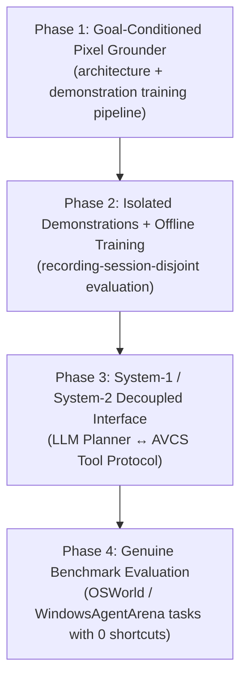

# AVCS // Artificial Visual Cortex System
## Master Mission, Reality Baseline & Research Roadmap

---

## 1. Executive Mission & Vision

The overarching mission of **AVCS (Artificial Visual Cortex System)** is to build a **Real-Time, Goal-Conditioned, Pure-Pixel Desktop Control System** that can operate a computer like a human:

1. **Aankh (System 1 - Visual Perception):** Perceives continuous desktop frames in real time directly from raw RGB framebuffer pixels—without relying on heavy OCR engines, accessibility trees (UIA/DOM), or OS inspect APIs.
2. **Dimag (System 2 - Cognitive Planning):** Understands the operator's high-level goal, breaks it down into sequential visual action steps, and adapts dynamically to screen state changes.
3. **Haath (Motor Control):** Dispatches smooth, human-like cursor movements and physical mouse/keyboard inputs to visually grounded targets, with hardware safety breakout failsafes.
4. **Verification (Optical Oracle):** Confirms that each action actually succeeded by observing fresh visual evidence on screen (optical flow, state changes, window transitions), never by assuming success or faking completions.

---

## 2. Honest Current State & Baseline (Unvarnished Truth)

To ensure scientific integrity and eliminate false assumptions, the current system state is explicitly defined as an **experimental research prototype**, not a general-purpose autonomous computer-use agent.

| Subsystem | Current Implementation | Measured Reality / Current Limitation | Production Status |
| :--- | :--- | :--- | :--- |
| **Frame Capture** | `Win32FastCapture` (GDI DIBSection) | Real-time RAM framebuffer capture (~56–60 FPS, <1ms grab overhead). | **Functional** |
| **Motor Execution** | `Win32CursorDriver` (SendInput) | Can move cursor and dispatch clicks/keystrokes; includes failsafe breakout. | **Functional primitive** (Cannot choose actions on its own) |
| **Cortical Neural Model** | `Cortex-2M` (`cortex_2m_best.pt`) | 2.43M params trained on **synthetic geometric shapes** (10.83% category accuracy). **Unproven on real UI**. | **Experimental** (Distribution shift to real desktop) |
| **Goal-Conditioned Grounder** | `GoalConditionedGrounder` (`avcs/goal_grounder.py`) | Pixel/query-conditioned dense click heatmap and real-demonstration trainer are implemented; no real-demonstration checkpoint exists yet. | **Implemented architecture; untrained / not action-ready** |
| **Language Gaze Grounding** | `LanguageGazeGrounder` | Character n-gram cross-correlation; does not yet reliably ground arbitrary desktop controls. | **Experimental prototype** |
| **Demonstration Recorder** | `avcs.training.demo_recorder` | Collects labeled click coordinates on isolated, foreground windows. | **Active Data Collection Tool** |
| **Cognitive Planning** | Multi-step task logic | 2.4M parameters cannot handle long-horizon planning. Requires external System-2 planner. | **Not Implemented Locally** |
| **End-to-End Autonomy** | Desktop workflows (e.g. Notepad) | Historical tests used scripted shortcuts (`Win+S`, `Ctrl+S`, `Alt+F4`) or file writes, not visual autonomy. | **Unproven / Faked in past** (Now Fail-Closed) |

---

## 3. Core Architectural Principles (Non-Negotiable Invariants)

1. **Zero-Shortcut Rule for Autonomous Evaluation:**
   When testing visual autonomy, the system must never cheat via keyboard macros (`Win+S`, `Ctrl+N`, `Ctrl+S`, `Alt+F4`), background OS API hooks, or Python filesystem writes. Every evaluated action must originate from visual target identification and physical motor input.
2. **Pure Pixels Mandate:**
   Never depend on browser DOM trees, accessibility APIs (UI Automation, MSAA), or OCR text-scraping crutches. The perception model must learn to ground directly on raw pixel visual features.
3. **Separation of System-1 and System-2:**
   - **System 1 (AVCS):** High-frequency visual perception, target grounding $(x, y)$, and motor servoing.
   - **System 2 (Cognitive Planner):** High-level task reasoning, sub-goal generation, and workflow error recovery (via LLM tool-calling).
4. **Strict Postcondition Verification:**
   Task completion must be judged by independent, out-of-band state oracles and verified visual deltas—never self-reported by the executing agent.
5. **Fail-Closed Safety & Hardware Failsafes:**
   Cursor control must always yield immediately to human operator breakout (corner failsafe / ESC emergency abort). No destructive testing on personal or unisolated environments.

---

## 4. Realistic 4-Phase Research Roadmap

### Phase 1: Goal-Conditioned Pixel Grounder (Architecture Implemented; Weights Not Trained)
- [x] Define a model that consumes raw RGB pixels and a target phrase and emits a dense spatial click-target heatmap.
- [x] Add a UTF-8 byte-query encoder and query-conditioned visual feature modulation; no OCR or accessibility text is consumed by the model.
- [x] Add a demonstration loader, recording-session-disjoint train/validation/test split, and recorder-manifest checks.
- [ ] Obtain recorded real-UI demonstrations before training. No trained weights are currently available for this model.

### Phase 2: Real-World Demonstrations and Grounding Training
- [x] Build safe, isolated demonstration recorder (`avcs.training.demo_recorder`).
- [ ] Record high-quality human demonstrations across standard Windows applications (Notepad, Calculator, Settings, File Explorer) in isolated disposable test windows. At least five separate sessions are required by the training split.
- [ ] Curate session-disjoint Train / Validation / Test sets. The current recorder labels click points, not target bounding boxes.
- [ ] Train `GoalConditionedGrounder` on genuine demonstrations. The synthetic checkpoint is not used as a pretrained real-UI model.
- [ ] Report validation click-point distance first; target-hit rate requires bounding-box labels and is not measured by the current recorder.
- [ ] Evaluate the held-out test split only after model choices are fixed. Offline metrics do not prove end-to-end desktop autonomy.

### Phase 3: Decoupled System-1 / System-2 Cognitive Architecture
- [ ] Formalize the System-1 tool interface:
  - `look_at(subgoal_query) -> (x, y, confidence)`
  - `move_and_click(x, y) -> visual_delta_detected`
  - `type_text(string) -> visual_delta_detected`
  - `inspect_window() -> scene_summary`
- [ ] Integrate with external System-2 cognitive planners (Ollama / local LLM / hosted API) where the LLM reasons about *what* to do, and AVCS handles *where* and *how* to see and click.

### Phase 4: Rigorous Sandbox Evaluation (OSWorld Alignment)
- [ ] Benchmark on standard, reproducible OS automation tasks (OSWorld / WindowsAgentArena subset).
- [ ] Strict out-of-band evaluation: verify actual application states on disk and OS handles without shortcut bypasses.
- [ ] Publish honest, auditable success rates with zero inflated claims.
