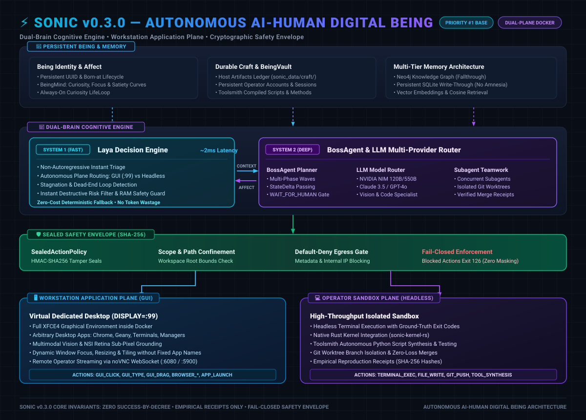
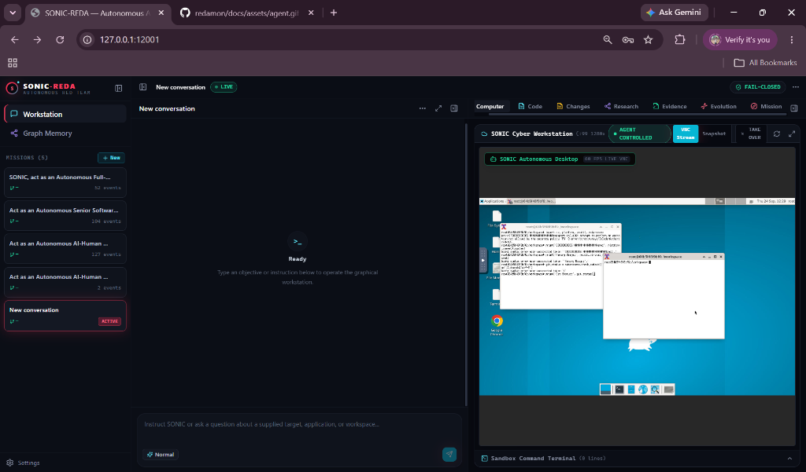
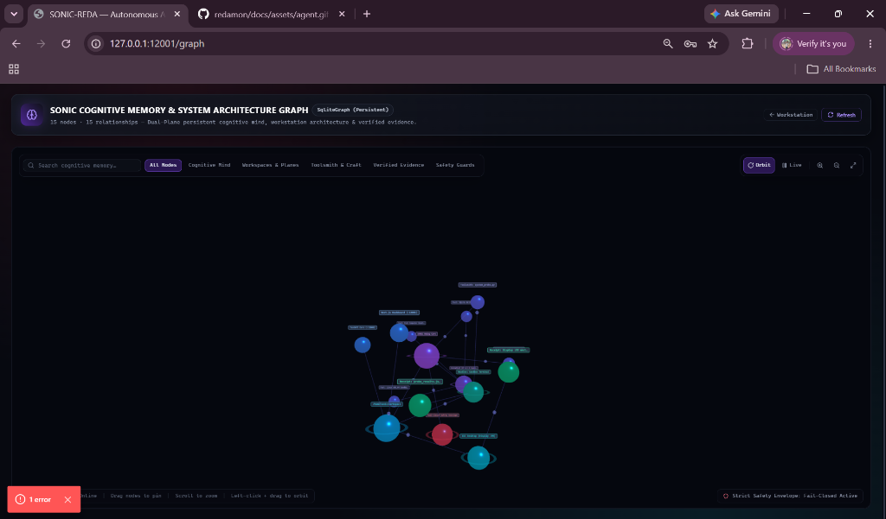

# ⚡ SONIC
### Autonomous AI-Human Digital Being & Workstation

[](https://github.com/nandkishorrathodk-art/sonic/releases/tag/v0.3.0)
[](https://www.python.org/downloads/)
[](https://nextjs.org/)
[](https://fastapi.tiangolo.com/)
[](https://www.docker.com/)
[](https://threejs.org/)

> **Codename:** SONIC (Autonomous AI-Human Digital Being)  
> **Version:** v0.3.0  
> **Status:** Full Dual-Plane Workstation Agency & 3D Cognitive Memory Graph  
> **Core Concept:** An autonomous AI-Human Digital Being operating its own dedicated personal computer workstation (`DISPLAY=:99` full graphical desktop + dedicated headless terminal). Combines human workstation fluency, persistent cognitive affect, toolsmithing, and verified empirical receipts — zero success-by-decree.

---

## 📸 Live Visual Showcase

<div align="center">

### 🏛️ 1. Complete System Architecture (v0.3.0)
*End-to-End Dual-Brain Cognitive Engine, Sealed Safety Envelope, and Dual-Plane Workstation Substrate.*



<br/><br/>

### 🖥️ 2. SONIC Workstation (Dual-Plane Desktop + Headless Terminal)
*Real-time AI workstation: Operating the full X11 graphical desktop (`DISPLAY=:99`) concurrently with a dedicated headless sandbox terminal.*



<br/><br/>

### 🧠 3. SONIC Cognitive Memory & System Architecture Graph (Interactive 3D WebGL)
*Interactive 3D Force-Directed Graph: Visualizing persistent Being identity, BeingMind cognitive affect curves, internalized facts, dual execution planes, toolsmith scripts, and empirical SHA-256 evidence.*



</div>

---

## 📑 Table of Contents
- [Live Visual Showcase](#-live-visual-showcase)
- [Overview](#-overview)
- [Product Requirements & Engineering Governance](#-product-requirements--engineering-governance)
- [Dual-Brain Architecture](#-dual-brain-architecture-system-1--system-2)
- [Core Architecture: The AI Being & Workstation](#-core-architecture-the-ai-being--workstation)
- [Key Capabilities & Subsystems](#-key-capabilities--subsystems)
- [Deep AI / ML Architecture](#-deep-ai--ml-architecture)
- [Repository Structure](#-repository-structure)
- [Quick Start Guide](#-quick-start-guide)
- [The Strict Core Invariants](#-the-strict-core-invariants)
- [Testing & Quality Assurance](#-testing--quality-assurance)

---

## 🌟 Overview

**SONIC** is an autonomous AI-Human Digital Being — a persistent, self-evolving colleague that operates its own dedicated personal computer workstation. Unlike conventional chatbots or single-purpose automation scripts, SONIC functions as an **independent agentic entity** with full computer agency.

It autonomously:
1. **Perceives** graphical application windows (Display `:99`) and headless terminal outputs simultaneously.
2. **Reasons** from first-principles using multimodal Large Language Models (LLMs) and Vision-Language Models (VLMs).
3. **Authors** its own custom tools (**Toolsmith**) and invents novel workflows (**Method Lab**) when off-the-shelf utilities are missing or insufficient.
4. **Reproduces & Verifies** every claim empirically in sandboxed runtime containers — zero unverified assertions.
5. **Survives restarts** with persistent SQLite-backed cognitive affect, vector embeddings, and Neo4j graph memory.

- 🖥️ **Full virtual computer control** — operates any GUI app, browser, or terminal concurrently
- 🧠 **True multi-agent intelligence** with Agent-to-Agent Graph Memory
- 🎯 **Autonomous observe → reason → act loop** — keeps going until the goal is proven complete
- 📋 **Mandatory Evidence Engine** — zero hallucination tolerance, every finding backed by real execution receipts
- 🔄 **Controlled self-development** with measurable improvement
- 🛡️ **Production-grade safety** + rollback (default-deny egress, scope, rate-limit)

---

## 📘 Product Requirements & Engineering Governance

SONIC's product direction and engineering rules are documented separately
from implementation details:

| Document | Purpose |
| :--- | :--- |
| [`docs/PRD.md`](docs/PRD.md) | Product identity, capability goals, non-functional requirements, product surfaces, and release acceptance criteria. |
| [`docs/RULES.md`](docs/RULES.md) | Immutable safety, anti-puppet, dual-plane, evidence, and dynamic-perception invariants. |
| [`AGENTS.md`](AGENTS.md) | Repository memory, implementation constraints, department ownership, and audit workflow for AI contributors. |
| [`docs/SONIC_ENGINEERING_OPERATING_MODEL.md`](docs/SONIC_ENGINEERING_OPERATING_MODEL.md) | Department/team/subsystem ownership, employee runtime, scoped contributors, Git workflow, CI, and release gates. |
| [`docs/ARCHITECTURE.md`](docs/ARCHITECTURE.md) | System architecture, runtime layers, cognitive loop, and organization integration. |
| [`docs/README.md`](docs/README.md) | Complete documentation index. |

### Organization-aware development

SONIC engineering work follows a traceable ownership chain:

```text
Department → Team → Subsystem → Employee/AI contributor
  → Project → Work item → Branch → Tests → Pull request → Review/CI → Release
```

The canonical ownership registry is
[`sonic-core/sonic/organization/architecture.py`](sonic-core/sonic/organization/architecture.py).
The persistent tenant-scoped runtime connects employees, projects, work items,
and employee-aware teamwork. Ownership provides engineering context; it does
not replace tenant isolation, workspace confinement, provider controls, or the
independent Safety policy.

The current delivery branch is
`agents/sonic-features-audit-request`; it contains the latest `development`
history and is intended for review through a pull request. It must not be
described as merged to `development` until the pull request and CI gates are
actually complete.

### Evidence-based audit workflow

Department audits are deliberately narrow:

1. Resolve the canonical department, team, and subsystem.
2. Inspect call sites, persistence boundaries, and existing tests.
3. Separate confirmed bugs from possible issues and test gaps.
4. Reproduce confirmed behavior and add a focused regression test.
5. Fix the root cause, then run relevant tests, lint, and type checks.
6. Report cross-department findings to their owning subsystem.
7. Distinguish local, CI, and live-workstation verification.

---

## 🧬 Dual-Brain Architecture (System 1 + System 2)

SONIC implements a **Dual-Brain cognitive model** inspired by Kahneman's dual-process theory:

| Layer | Engine | Latency | Purpose |
| :--- | :--- | :--- | :--- |
| **System 1** (Fast) | Laya Decision Engine | ~2ms | Instant triage, safety scoring, plane routing, curiosity evaluation |
| **System 2** (Deep) | LLM Router (Anthropic/OpenAI/Groq/Ollama) | ~500ms–3s | Chain-of-thought reasoning, code generation, multi-step planning |

### System 1 — Laya Non-Autoregressive Decision Engine
- **Module:** `sonic/llm/laya_engine.py`
- **3-Tier Fallback:** Remote HTTP API → Local `laya.Router` → DenseVectorizer cosine projection
- **Built-in Presets:** `triage` (plane routing), `guard` (risk assessment), `verification` (receipt validation), `curiosity` (novelty scoring)
- **RAM Guard:** Automatically blocks local model loading when free RAM is below threshold
- **API:** `GET /llm/laya/status`, `POST /llm/laya/predict`

### System 2 — LLM Multi-Provider Router
- **Module:** `sonic/llm/router.py`
- **Providers:** Anthropic Claude, OpenAI GPT, Groq, NVIDIA NIM, Ollama, xAI, DeepSeek, OpenRouter
- **Task-Based Routing:** `reasoning`, `vision`, `code`, `embedding` → each routes to the optimal model
- **Multimodal:** Accepts screenshots, DOM snapshots, and structured observations

### How They Work Together
1. **System 1 triages first** — decides execution plane (GUI vs headless), evaluates action safety risk, and detects loop stagnation — all in under 5ms with zero LLM API calls.
2. **System 2 reasons deeply** — given the System-1 context, the LLM performs chain-of-thought reasoning to select the precise action, generate code, or plan multi-step strategies.
3. **Cross-feedback** — System 1 learns from System 2's outcomes (novelty scoring feeds back into curiosity affect curves in `BeingMind`).

---

## 🖥️ Core Architecture: The AI Being & Workstation

<div align="center">
  
</div>

<details>
<summary><b>View Text-Based ASCII Architecture Map</b></summary>

```
┌────────────────────────────────────────────────────────────────────────────────────────┐
│                                    SONIC AI-HUMAN BEING                                │
│            Persistent Mind (sqlite) │ Vector Memory (Embeddings) │ Graph Memory        │
│                Curiosity Loop │ Self-Reflection │ Craft Ledger (Host Disk)             │
└───────────────────────────────────────────┬────────────────────────────────────────────┘
                                            │
                                            ▼
┌────────────────────────────────────────────────────────────────────────────────────────┐
│                              DUAL-BRAIN COGNITIVE ENGINE                               │
│   System 1: Laya (Fast Triage)  ←→  System 2: LLM Router (Deep Reasoning)            │
│                 BossAgent (Multi-Phase Planner) ↔ TaskGraph Dependency Wave            │
│                       LLM Multi-Provider Router (Anthropic/OpenAI/Groq/Ollama)         │
└───────────────────────────────────────────┬────────────────────────────────────────────┘
                                            │
                                            ▼
┌────────────────────────────────────────────────────────────────────────────────────────┐
│                              IMMUTABLE SAFETY ENVELOPE (SHA-256)                       │
│                     SealedActionPolicy ↔ ScopeChecker ↔ SandboxTierRouter              │
│                       Zero Host Escapes │ Egress Filter │ Rate Limiting                │
└───────────────────────────────────────────┬────────────────────────────────────────────┘
                                            │
                                            ▼
┌────────────────────────────────────────────────────────────────────────────────────────┐
│                        DUAL-PLANE DOCKER WORKSTATION PROVIDER                          │
│                                                                                        │
│  🖥️ Workstation Application Plane (GUI)       💻 Operator Sandbox Plane (Headless)     │
│  - Virtual X11 Display (:99)                  - Non-graphical high-throughput terminal  │
│  - XFCE4 Desktop & Dynamic Window Tiling      - Custom Python probes & AST auditing    │
│  - x11vnc (:5900) + noVNC Websockify (:6080)  - Native Rust kernel bridges             │
│  - Real Multimodal Vision Grounding           - Toolsmith compilation & execution      │
└────────────────────────────────────────────────────────────────────────────────────────┘
```
</details>

### 1. Dual-Plane Operational Model
SONIC does not silo itself into a terminal-only script or a sluggish GUI-only recorder:
- **Workstation Application Plane (Computer-Use)**: Interacts with the full graphical desktop environment (X11 via `GUI_*`, `APP_*`, `BROWSER_*`). Operates any arbitrary desktop application, tool, debugger, or browser installed on the OS via visual perception without hardcoded app names.
- **Operator & Sandbox Plane (Direct Headless Execution)**: Dedicated high-speed execution plane (`TERMINAL_EXEC`, `SECURITY_TOOL`, `FILE_*`, `GIT_*`). Heavy scripts, socket listeners, and source audits execute directly in the container sandbox without cluttering the screen or wasting visual tokens.
- **Zero Puppet Scripts**: SONIC autonomously decides which plane and tool to use based on observations and goals.

### 2. Persistent Being & Craft
- **Identity & Affect (`sonic/being/identity.py`)**: Persists being identity, mood metrics (`curiosity_drive`, `focus`, `satiety`), and learned facts across reboots.
- **Always-On Life Loop (`sonic/being/life_loop.py`)**: Runs when no operator task is active, exploring, hypothesizing, and learning autonomously under the safety envelope.
- **Durable Craft (`sonic/being/craft.py`)**: Persists authored scripts and notes to host storage (`sonic_data/craft/`).

---

## ⚡ Key Capabilities & Subsystems

| Subsystem | Module Path | Purpose |
| :--- | :--- | :--- |
| **Boss Agent** | `sonic/computer_use/boss.py` | Multi-phase strategic planner; decomposes goals into dependency waves. |
| **Computer-Use Agent** | `sonic/computer_use/agent.py` | Core observe → reason → act → verify closed loop. |
| **Laya System-1 Engine** | `sonic/llm/laya_engine.py` | Fast non-autoregressive triage, safety scoring, and curiosity evaluation. |
| **Vision Grounding** | `sonic/computer_use/grounding.py` | Resolves visual elements to exact pixel coordinates from raw screenshots. |
| **Docker Computer** | `sonic/computer/docker_computer.py` | Direct workstation container control (XFCE4, Xvfb `:99`, x11vnc, wmctrl). |
| **Safety Envelope** | `sonic/safety/action_policy.py` | Fail-closed policy engine enforcing egress, rate limits, and path bounds. |
| **Sealed Policy** | `sonic/safety/sealed.py` | SHA-256 tamper-evident cryptographic wrapper around safety policies. |
| **Toolsmith** | `sonic/evolution/toolsmith/` | Generates, tests, and deploys custom Python tools on-the-fly. |
| **Method Lab** | `sonic/evolution/method_lab/` | Synthesizes novel workflows and methods when existing tools are insufficient. |
| **Evidence Engine** | `sonic/evidence/` | Verifies and cryptographically hashes reproduction receipts for all findings. |
| **Research Swarm** | `sonic/researcher/` | Concurrent specialist agents auditing surfaces in parallel. |
| **Graph & Vector Memory** | `sonic/memory/` | Dual Neo4j / SQLite property graph and embedding vector storage. |
| **3D Cognitive Memory Graph** | `sonic-dashboard/app/graph/` | Interactive WebGL 3D force-directed graph visualizing Being mind, affect curves, dual planes, toolsmith craft, and empirical evidence. |

---

## 🧠 Deep AI / ML Architecture

SONIC is designed from the ground up as an **AI/ML-Native system**, eliminating rigid heuristics in favor of probabilistic reasoning and learned representations:

1. **Multimodal Perception & Computer Vision:**
   - Screenshots of Display `:99` are captured via `scrot -p` and processed directly by Vision-Language Models (VLMs) like Claude 3.5 Sonnet, GPT-4o, Gemini 1.5 Pro, or local Qwen2-VL.
   - Grounding algorithms convert bounding-box tokens (`<|box_start|>ymin,xmin,ymax,xmax<|box_end|>`) into sub-pixel click targets.

2. **Cognitive ReAct Decision Loop:**
   - Every step follows `Observation -> Multimodal LLM Chain-of-Thought -> Structured Action -> Environment Feedback`.
   - Stderr reflection: Execution failures prompt self-correction, syntax adjustments, and dynamic pivoting.

3. **High-Dimensional Vector Memory (RAG):**
   - Past outcomes and knowledge are embedded via dense vector models (`text-embedding-3`, `BGE-m3`, `SentenceTransformers`) and retrieved using cosine similarity.

4. **Curiosity & Novelty Engine:**
   - Quantifies the information gain of new observations using vector distance. High novelty states incentivize deeper autonomous exploration during idle curiosity loops.

5. **Dual-Brain Fast/Slow Cognition:**
   - System 1 (Laya) handles instant triage decisions in ~2ms; System 2 (LLM) handles deep reasoning. Both operate concurrently, with System 1 providing context to System 2.

---

## 📁 Repository Structure

```
.
├── sonic-core/                         # Python Backend (FastAPI, Python 3.12+)
│   ├── sonic/
│   │   ├── api/routes/                 # REST Endpoints (Workstation, Sessions, Auth, Missions)
│   │   ├── being/                      # Persistent Being Identity, Affect, Craft, & Life Loop
│   │   ├── computer/                   # Docker Workstation & Sandbox Providers
│   │   ├── computer_use/               # BossAgent, ComputerUseAgent, Visual Grounding
│   │   ├── evidence/                   # Empirical Evidence Engine & Receipts
│   │   ├── evolution/                  # Toolsmith, Method Lab, Dynamic Strategy Engine
│   │   ├── llm/                        # Multi-LLM Providers + Laya System-1 Decision Engine
│   │   ├── memory/                     # Neo4j & Persistent SQLite Graph Memory, Vector Store
│   │   ├── researcher/                 # Concurrent Specialist Agents
│   │   ├── safety/                     # Cryptographic Sealed Action Policy & Scope Enforcement
│   │   └── tools/                      # Security Tool Adapter Registry (nmap, nuclei, ffuf)
│   └── tests/                          # 350+ Pytest Test Suites
├── sonic-dashboard/                    # Dashboard (Next.js 14, React, Tailwind CSS)
│   ├── app/                            # Next.js App Router (Workstation, Missions, Evidence)
│   ├── components/                     # Workstation GUI, Live VNC Stream, Terminal Timeline
│   └── lib/                            # API Client, Token Auto-Refresh, WebSocket Streaming
├── sonic-cli/                          # Command-Line Interface (Typer + Rich)
├── docker/                             # Workstation Container Configs & Entrypoints
├── configs/                            # System Safety Rules & Model Routing YAMLs
├── AGENTS.md                           # Core Repository Memory & Operational Rules
└── README.md                           # This Documentation
```

---

## 🚀 Quick Start Guide

### Prerequisites
- **Python 3.12+**
- **Node.js 20+** (for dashboard)
- **Docker & Docker Compose**
- LLM API Key (Groq, Anthropic, OpenAI, xAI, or local Ollama/vLLM)

### 1. Clone & Configure Environment
```bash
git clone https://github.com/nandkishorrathodk-art/sonic.git
cd sonic

# Create local environment configuration
cp .env.example .env
# Edit .env with your API keys and credentials
```
Edit `.env` to configure your preferred LLM provider (`GROQ_API_KEY`, `ANTHROPIC_API_KEY`, or `OPENAI_API_KEY`).

### 2. Start Infrastructure & Workstation Container
```bash
# Start Neo4j & Redis (Optional: backend auto-falls back to persistent SQLite if offline)
docker-compose up -d

# Start the Docker Workstation
docker start sonic-desktop-workstation
```
> The live XFCE4 desktop stream is available at: **`http://localhost:6080/vnc.html`**

### 3. Install & Start Backend
```bash
# Install backend in editable mode
pip install -e "sonic-core[dev]"

# Launch the FastAPI backend on port 12000
APP_ENV=development python -m uvicorn sonic.api.main:app --port 12000 --reload
```
> Interactive API Documentation: **`http://127.0.0.1:12000/docs`**

### 4. Install & Start Next.js Dashboard
```bash
cd sonic-dashboard
npm install
npm run dev -p 12001
```
> Open your browser at: **`http://127.0.0.1:12001`**

---

## 🛡️ The Strict Core Invariants

The following invariants are hard-enforced in code and prompts:

1. **Zero Hardcoded Application Names:** Control flow and intent routing never assume fixed binaries. Applications are discovered dynamically from `$PATH`, `.desktop` entries, and active OS window titles.
2. **Zero Scripted Puppet Heuristics:** No rigid keyword trees, canned checklists, or regex intent steering. The agent reasons freely from live observations.
3. **Zero Host Execution:** All actions, terminal commands, and tool authoring execute inside isolated Docker container sandboxes. Host escape attempts trigger immediate fail-closed termination.
4. **Empirical Falsification:** Every finding, milestone completion, and knowledge claim must be backed by verifiable in-sandbox execution receipts.
5. **Fail-Closed Safety Envelope:** Safety policies are cryptographically hashed (`SealedActionPolicy`). Any unauthorized runtime modification triggers an immediate `DENY`.

---

## 🧪 Testing & Quality Assurance

SONIC features extensive test suites ensuring regression-free execution across safety, reasoning, and tools:

```bash
# Run the core regression and safety suites
python -m pytest sonic-core/tests/test_phase_plan6_safety_envelope.py \
                 sonic-core/tests/test_ai_and_control_upgrade.py \
                 sonic-core/tests/test_p0_security_hardening.py \
                 sonic-core/tests/test_safety_sealed_policy.py

# Run Laya System-1 integration tests
python -m pytest sonic-core/tests/test_laya_system1_engine.py \
                 sonic-core/tests/test_laya_end_to_end.py

# Run full suite
python -m pytest sonic-core/tests/
```

---

## Core Principles

1. **Evidence > Claims** — No finding without proof
2. **Speed without chaos** — Fast, never reckless
3. **Shared intelligence** — Graph Memory for all agents
4. **Self-improvement** — Only through measured experiments
5. **Immutable safety** — Core rules cannot be modified by agents
6. **Human authority** — Final say on high-risk actions

---

## 📄 License

Proprietary — All rights reserved.  
Unauthorized copying, modification, distribution, or commercial deployment is strictly prohibited.
