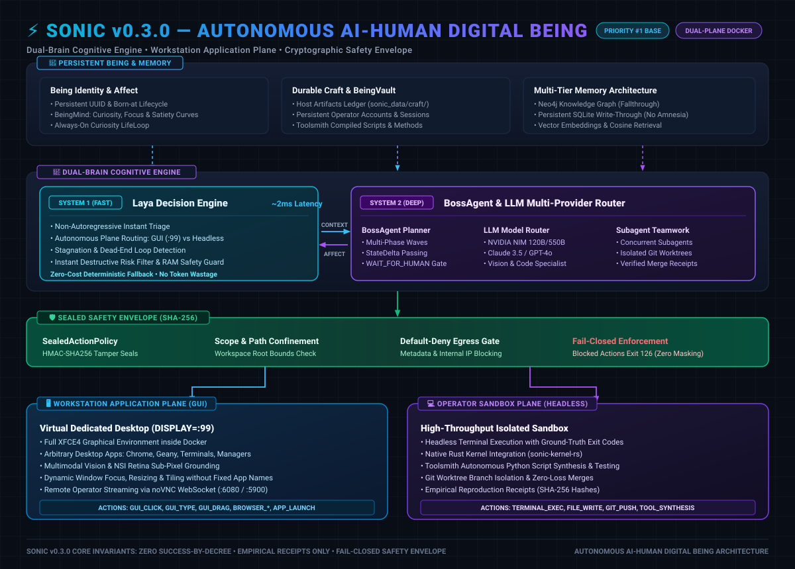

# SONIC architecture

## Product boundary

SONIC is intended to be a general-purpose AI computer user: it receives an
operator's desired outcome, reasons about the available environment, selects
appropriate computer capabilities, and reports only what it can verify. This
describes the product direction; it does not claim arbitrary installed
applications or end-to-end tasks are already reliable.

The authoritative acceptance contract is
[SONIC_COMPUTER_USER_GOAL.md](SONIC_COMPUTER_USER_GOAL.md). Ownership of
repository subsystems is defined in
[`architecture.py`](../services/core/sonic/organization/architecture.py).
For the step-by-step current AVCS-to-System-2 and GUI action path, see
[SONIC_AVCS_SYSTEM_FLOW.md](SONIC_AVCS_SYSTEM_FLOW.md).

## Runtime at a glance



```text
Operator outcome
  -> API/workstation session
  -> Boss planning, delegation, evidence review and replanning
  -> ordinary ComputerUseAgent workers
       -> fresh workstation frame, processed locally by AVCS
       -> compact AVCS reflex summary for workstation reasoning
       -> reason about the assigned objective
       -> ground a visible GUI action or use an allowed execution capability
       -> action policy/provider dispatch and recorded receipt
       -> observe the resulting state
  -> independent Judge checks GUI completion against fresh evidence
  -> report verified results, partial progress, blockers or uncertainty
```

Chat and observation-only requests are not workstation execution. Actionable
workstation objectives enter Boss orchestration. Boss delegates to ordinary
`ComputerUseAgent` workers; there is no dedicated browser-specialist route.
Website work, when requested, is handled as visible-desktop work by those
workers.

## Main code areas

| Area | Source | Responsibility |
|---|---|---|
| Workstation and API | `services/core/sonic/api/routes/workstation.py` | Sessions, workstation actions, worklog and mission entry points |
| Orchestration | `services/core/sonic/computer_use/boss.py` | Task analysis, bounded worker dispatch, receipts, review and replanning |
| Computer-use worker | `services/core/sonic/computer_use/agent.py` | Observation, reasoning, action dispatch and worker traces |
| Research graph models | `services/core/sonic/research/attack_graph_models.py` | Shared typed node, edge and path contracts for graph traversal |
| Desktop provider | `services/core/sonic/computer/docker_computer.py` | Local Docker workstation access and state/screenshot observations |
| AVCS pixel reflex | `services/core/sonic/computer_use/avcs_perception.py` and workstation providers | Local pixel-derived scene/change state; optional checkpoint-gated target grounder |
| Grounding | `services/core/sonic/computer_use/grounding.py` | Coordinate-space parsing and grounded target resolution |
| Policy | `services/core/sonic/safety/` | Action policy, scope, egress and sealed-policy controls |
| Independent review | `services/core/sonic/agents/judge.py` | Checks completion proposals against fresh evidence and worker receipts |
| Dashboard | `apps/dashboard/` | Operator-facing workstation and work status |
| Local developer CLI | `apps/cli/` | Repository-scoped developer agent and command-line interface |
| Native kernel | `packages/kernel/src/` | Native safety, perception and IPC runtime |
| AVCS | `packages/avcs/` | Visual-perception framework, adapters and evaluation |

Exact wiring varies by route and provider. A component's presence in this table
does not prove every route uses it; verify the relevant production call path
before making behavior claims.

## Repository structure

This is a map of the existing repository boundaries, not a proposed file move.
The complete subsystem-to-department registry is maintained in
[`architecture.py`](../services/core/sonic/organization/architecture.py).

```text
sonic/
├── apps/
│   ├── dashboard/                 Next.js operator interface
│   └── cli/                       Standalone local developer CLI
├── services/core/sonic/           Python API and runtime
│   ├── api/routes/                HTTP routes and application entry points
│   ├── computer_use/              Boss, ComputerUseAgent, GUI contracts, AVCS bridge
│   ├── computer/                  Workstation providers, including Docker
│   ├── agents/                    Judge and other agent implementations
│   ├── safety/                    Action policy, scope and sealed controls
│   ├── llm/                       Provider routing and model contracts
│   ├── memory/                    Persistent graph and vector memory
│   ├── brain/ research/ world/    Reasoning, evidence models and environment state
│   └── being/ evolution/           Identity, learning and controlled evolution
├── packages/
│   ├── avcs/
│   │   ├── avcs_sdk/              Async client/backend contract + repository adapter
│   │   ├── avcs/                  HumanEye SDK, drivers, MCP, training and tooling
│   │   ├── forge/vision/           ScreenEye/cortex model and capture pipeline
│   │   ├── adapters/               Framework adapters and examples
│   │   └── tests/                 Package-level SDK and perception tests
│   └── kernel/                    Native Rust kernel and IPC
├── docs/                          Architecture, product contracts and guides
├── configs/                       Runtime configuration
├── docker/                        Workstation and service container assets
└── infra/                         Deployment and infrastructure definitions
```

For the live interaction sequence, follow
[AVCS/System 1 → System 2 → grounded action → Judge](SONIC_AVCS_SYSTEM_FLOW.md).
For subsystem ownership, use the registry rather than inferring owners from
these folder names.

### AVCS SDK and adjacent components

The AVCS package contains developer-facing APIs and experiments in addition
to SONIC's pixel-reflex component:

| Package component | Intended job | SONIC workstation status |
|---|---|---|
| `avcs_sdk.AVCSClient` + `RepositoryAVCSBackend` | Async observe/target/action contract, freshness checks, action IDs and broker-backed execution | Not imported or wired by `services/core`; package examples/tests use this separate backend |
| `avcs.sdk.HumanEyeClient` | Higher-level perception, events, scene/memory helpers, motor methods, optional metering/auth | Standalone SDK; not SONIC's workstation agent/provider path |
| `forge.vision.cortex.ScreenEye` | Cortex inference/capture API for package consumers | Experimental package API; not the active SONIC AVCS reflex processor |
| `avcs.mcp`, `adapters/`, `drivers/` | MCP interface and integrations for external agent frameworks/providers | Package integrations; no evidence they are called by SONIC workstation flow |
| `avcs/training/`, benchmarks and demos | Record/train/evaluate experimental perception and target-grounding models | Separate tooling; only a valid evaluated checkpoint can enable SONIC's optional goal-grounding path |

In SONIC's current workstation path, `DockerComputerProvider` captures and
locally processes frames through `ComputerUseAgent`'s `AVCSPerception`
integration; System 2 consumes its bounded reflex summary. It does not invoke
the AVCS SDK's client loop, MCP server, adapter layer or SDK motor methods.
The `RepositoryAVCSBackend` also defaults to an interactive synthetic capture
adapter and a virtual cursor, so its demos/tests are not proof of real VNC
control or live SONIC integration. Do not treat SDK method names, package
examples or synthetic test results as capability evidence.

## Dependency boundaries

Keep package dependencies pointing toward stable contracts and away from
runtime composition:

```text
API / application composition
  -> Boss and agents
  -> computer-use coordinator
  -> perception, computer/provider and safety contracts
  -> concrete providers and external runtimes
```

- Put shared immutable data contracts in leaf modules. For example,
  `computer_use/perception_models.py` owns `PerceptionSnapshot`; the GUI world
  graph depends on this contract rather than importing the perception bus. The
  bus may compose the graph lazily without creating a reverse dependency.
- Keep concrete provider selection, route registration and long-lived service
  construction at composition boundaries. Lower-level contracts should not
  import API routes or application startup code.
- Prefer protocols, injected factories and typed contracts over importing a
  large coordinator module solely for a type or construction helper.
- Preserve intentional compatibility imports while moving implementation.
  Remove a compatibility path only after callers and tests have migrated.
- Do not split modules by arbitrary line count. Extract a responsibility when
  it has a clear interface, independent lifecycle, or focused test boundary.

## Computer and execution capabilities

The normal local workstation route uses `DockerComputerProvider`. Its graphical
desktop and separate execution capabilities complement one another. The
operator's requested outcome and live state should determine which capability
is appropriate. A GUI-only assignment must stay GUI-only; terminal work must
not be silently substituted for the requested visible interaction.

The current Docker and Daytona workstation screenshot paths validate a fresh
frame and process its pixels locally through `AVCSPerception`. The resulting
AVCS reflex state includes pixel-derived properties such as a frame index,
dimensions, scene hash, brightness/contrast, change and motion estimates,
regions, and reflex events. Workstation reasoning receives a compact,
allowlisted text summary; screenshot bytes are not included in that reasoning
request. This describes the active workstation perception path, not a
repository-wide removal of OCR, NSI, accessibility, or DOM-related code.

AVCS reflex state is not semantic UI understanding: it does not identify
controls or application meaning, prove that a pointer target is correct, or
verify keyboard focus. An optional local target-grounding model is accepted
only when its checkpoint passes training-provenance, held-out point-accuracy,
and empirical query-score operating-point checks. Each proposed target must
also meet that checkpoint's recorded score threshold; the raw heatmap peak is
not treated as a calibrated probability. No live acceptance evidence here
establishes a ready, reliable grounding checkpoint. If grounding or fresh-frame
validation is unavailable or inconclusive, the affected action must fail
closed. GUI text entry remains unavailable without an evaluated local
focus-verification capability.

The GUI Judge processes a fresh screenshot locally through AVCS and does not
send screenshot pixels to a model. AVCS pixel change, motion, reflex events, or
a worker completion proposal alone are not evidence that the operator's
semantic postcondition was met. Until a validated local task-verification head
exists, GUI Judge verdicts remain inconclusive; task completion must not be
claimed from reflex telemetry. No live AVCS GUI acceptance or OSWorld-2
comparative benchmark is documented; these implementation contracts do not
establish arbitrary-application success or superiority over another system. See the
[perception contract](SONIC_COMPUTER_USER_GOAL.md#avcs-only-workstation-perception-current-contract)
for details.

This is not a guarantee of complete event subscriptions, zero-latency updates,
or reliable operation in every application. Other providers may use different
observation paths.

## Completion and evidence

- Boss owns task analysis, delegation, evidence review and replanning.
- A worker's `GOAL_COMPLETE` is a handoff proposal, not a success verdict.
- GUI completion requires a Judge decision based on fresh desktop evidence and
  worker action receipts.
- Missing, stale, ambiguous or inconclusive evidence cannot establish success.
- An unchanged frame/state is inconclusive evidence, not proof that an action
  succeeded.
- Unit tests validate code contracts; they do not demonstrate a real,
  multi-application workstation task.

## Safety and operational limits

Safety controls are implemented across Python policy, scope/egress helpers,
providers and, where wired, the native kernel bridge. Do not assume every
network path or provider has identical enforcement. Audit the actual dispatch
path before changing or documenting a boundary. The workstation container is
not, by itself, a security boundary against every host or Docker-daemon risk.
Do not expose raw VNC/noVNC ports beyond loopback without an independently
secured access design.

Production compose selects an explicitly configured Daytona workstation
provider; local Docker development and production deployment are not
interchangeable. Production readiness must be evaluated for the exact deployed
configuration.

## Historical notes

Older diagrams, phase logs and design documents describe capabilities,
providers, browser integrations or aspirations that have since changed. Treat
them as historical unless current source wiring and task-specific evidence
confirm the claim. The files under `docs/assets/` include historical UI
screenshots; they are not current live captures.
