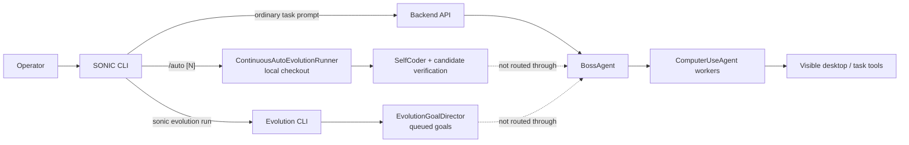

# SONIC Self-Evolution Architecture

This diagram describes the current code paths, not a guarantee that every
candidate will be fixed successfully. SONIC's Self-Evolution is a local
codebase workflow; it is separate from Boss's orchestration of ordinary
computer-use tasks.

## Entry points and system boundaries

- **`/auto`** starts a local continuous runner from the CLI's selected Git
  checkout. It does not send the work to the backend Boss.
- **`sonic evolution run`** drains goals already stored in the evolution goal
  queue. It is a distinct evolution entry point, not the `/auto` loop.
- **Ordinary prompts** go through the backend and Boss; they are not the
  Self-Evolution coder.

## `/auto` candidate lifecycle

```mermaid
flowchart TD
    START["Operator runs `/auto N`"] --> CLI["CLI resolves local Git repo root"]
    CLI --> RUNNER["ContinuousAutoEvolutionRunner"]

    RUNNER --> SCAN["Signal discovery on active checkout"]
    SCAN --> PYTEST["Run available `services/core/tests/` and `apps/cli/tests/`<br/>attribute failures to editable source<br/>(timeout: `SONIC_EVOLUTION_TEST_TIMEOUT`, default 600 s)"]
    SCAN --> AUDIT["Static audit + TODO/FIXME/HACK<br/>and no-op marker scan"]
    PYTEST --> SIGNAL["Signals: test failures first,<br/>then audit and marker findings"]
    AUDIT --> SIGNAL

    SIGNAL --> FOUND{"Any signal?"}
    FOUND -->|No, scans completed| IDLE["Wait / next bounded cycle"]
    SCAN -->|Scan error| SCANERROR["Emit cycle_error;<br/>do not report a clean repository"]
    IDLE --> SCAN
    FOUND -->|Yes| CANDIDATE["SelfCoderCandidateStore"]

    SIGNAL -->|"pass exact selected signal"| CANDIDATE
    CANDIDATE --> BASE["Record HEAD/base state"]
    BASE --> WT["Create detached Git worktree"]
    WT --> CODER["Create SelfCoder in worktree"]
    CODER --> PINNED["SelfCoder.run() uses the supplied signal<br/>without rediscovering"]
    PINNED --> CYCLE["SelfCoder.run_cycle(signal, target, category)"]

    CYCLE --> INVESTIGATE["Resolve configured ModelRouter;<br/>CodingAgent investigates with read-only tools<br/>read / grep / inspect tests"]
    INVESTIGATE --> GOAL["EvolutionGoalDirector creates<br/>file-scoped goal"]
    GOAL --> PATCH["PatchSynthesizer asks LLM<br/>for a unified diff"]
    PATCH --> PATCHCHECK{"Diff applies, changes real code,<br/>and avoids protected paths?"}
    PATCHCHECK -->|No| FAIL["Reject / record no candidate"]
    PATCHCHECK -->|Yes| EVOLVER["CodebaseEvolver applies patch<br/>with snapshots"]
    EVOLVER --> GATES["AST + target tests + import checks<br/>+ security regression"]
    GATES --> GATEPASS{"All gates pass?"}
    GATEPASS -->|No| ROLLBACK["Rollback snapshots;<br/>candidate discarded"]
    GATEPASS -->|Yes| REPORT["Report-only result:<br/>capture exact diff, restore worktree"]

    REPORT --> RETEST["CandidateStore reapplies exact diff<br/>in detached worktree"]
    RETEST --> FULL["Import checks + full configured test dirs<br/>`services/core/tests` and `apps/cli/tests`<br/>+ security regression"]
    FULL --> FULLPASS{"All verification receipts pass?"}
    FULLPASS -->|No| ROLLBACK
    FULLPASS -->|Yes| RECORD["Save verified candidate + exact diff,<br/>integrity hash and test receipts;<br/>remove detached worktree"]
    RECORD --> READY["Report candidate for operator review;<br/>active checkout unchanged;<br/>no commit or push"]
    READY --> NEXT["Report result; next bounded cycle"]
    FAIL --> NEXT
    ROLLBACK --> NEXT
    NEXT --> SCAN
```

### What the coder actually does

1. **Finds a signal:** `SelfCoder.discover_signals()` runs pytest and looks for
   source-attributed failures, then static-audit findings, then TODO-like
   markers. A TODO is a work signal, not proof of a bug.
2. **Investigates:** `CodingAgent` asks the configured LLM to inspect the real
   repository using bounded tools. The investigation in this flow is
   read-only.
3. **Proposes:** `PatchSynthesizer` asks the LLM for a unified diff and checks
   that it applies cleanly, changes actual code, and does not touch protected
   files.
4. **Verifies and records:** `CodebaseEvolver` runs code and safety gates;
   `SelfCoderCandidateStore` repeats verification in a detached worktree, then
   persists the exact diff, integrity hash, and test receipts as a `verified`
   candidate. The active checkout is unchanged; no commit or remote push occurs.
   An operator must explicitly approve a candidate before it is applied.

## Separate queued-goal evolution path

```mermaid
flowchart LR
    OP["Operator / automation"] --> CMD["`sonic evolution run`"]
    CMD --> DIRECTOR["EvolutionGoalDirector"]
    DIRECTOR --> QUEUE["Read queued goals<br/>in priority order"]
    QUEUE --> ANALYZE["Analyze goal + target files"]
    ANALYZE --> SYNTH["PatchSynthesizer"]
    SYNTH --> EVOLVE["CodebaseEvolver in report-only mode"]
    EVOLVE --> CHECKS["Protected paths + diff/AST<br/>tests + imports + security"]
    CHECKS --> RESULT{"Checks pass?"}
    RESULT -->|No| ROLLBACK["Rollback / retain failed goal"]
    RESULT -->|Yes| RECORD["Persist exact diff + verification report<br/>on the goal; restore checkout"]
    RECORD --> REVIEW["Operator reviews saved proposal"]
    REVIEW -->|Explicit `--auto-promote` on a run| COMMIT["Apply, verify and commit"]
    COMMIT --> PUSH{"Explicit `--push`?"}
    PUSH -->|Yes| REMOTE["Push"]
    PUSH -->|No| DONE["Finish locally"]
    REVIEW -->|No| DONE
```

This lane uses the queued `EvolutionGoalDirector` and `CodebaseEvolver`
directly. It does not use the `/auto` runner's outer signal scan and candidate
worktree lifecycle. `sonic evolution run`, `goal --execute`, and `patch` now
default to recording verified proposals without changing the active checkout.
Committing requires explicit `--auto-promote`; remote pushing additionally
requires explicit `--push`.

## Current caveats from the implementation and recent test

- `/auto` now passes its selected signal (description, target file, and
  category) into the candidate worktree. The candidate uses that signal instead
  of rediscovering a different issue. This does not by itself make arbitrary
  external repositories or test suites discoverable: the outer signal scan
  still searches the configured SONIC source roots and runs the configured test
  scan.
- The signal scan runs the available `services/core/tests/` and
  `apps/cli/tests/` suites with the same env-overridable timeout as the verification gate
  (`SONIC_EVOLUTION_TEST_TIMEOUT`, default 600 s); it is not yet an efficient
  arbitrary external-demo test selector.
- `/auto` resolves the configured `ModelRouter` for its read-only
  `CodingAgent` investigation. If no configured provider is usable, the
  investigation remains incomplete and patch synthesis is not attempted.
- `/auto`, the `/self-coder/run` API, and the periodic self-coder loop record
  verified candidate diffs without applying them, committing, or pushing.
  Candidate approval is a separate operator action.
- Patch synthesis now also requires a completed investigation that successfully
  read the exact target source file. A `finish` call, unrelated tool use, or
  diagnosis without target-file evidence is insufficient.
- Pytest collection/usage/runtime failures and static-audit failures are
  surfaced as scan errors; they are not converted into an idle/clean result.
- In the recent demo attempt, the candidate did not produce a patch: the first
  `/auto` run reached a SelfCoder cleanup error; after that lifecycle fix, a
  target-scoped attempt was rejected when the configured providers returned
  NVIDIA 403 and Groq 429. The demo's 23-contract baseline had 22 failures and
  1 pass, but no demo fix was verified.
- Passing unit tests or a model-generated diff alone does not establish
  successful evolution. Candidate-only runs retain their diff and verification
  receipts for review; they do not promote it into the active checkout.

## Source files

- [`apps/cli/sonic_cli/repl.py`](../apps/cli/sonic_cli/repl.py) — `/auto`
  entry point.
- [`continuous_runner.py`](../services/core/sonic/evolution/continuous_runner.py) —
  continuous `/auto` loop.
- [`self_coder.py`](../services/core/sonic/evolution/self_coder.py) — signals,
  report-only cycles, and target test discovery.
- [`coding_agent.py`](../services/core/sonic/evolution/coding_agent.py) — bounded
  tool-using investigation.
- [`patch_synthesizer.py`](../services/core/sonic/evolution/patch_synthesizer.py) —
  LLM unified-diff proposal and validation.
- [`self_coder_candidates.py`](../services/core/sonic/evolution/self_coder_candidates.py) —
  detached worktree verification and guarded application.
- [`codebase_evolver.py`](../services/core/sonic/evolution/codebase_evolver.py) —
  protected-path, AST, test, import, security, rollback, and promotion gates.
- [`goal_director.py`](../services/core/sonic/evolution/goal_director.py) and
  [`cli.py`](../services/core/sonic/evolution/cli.py) — queued-goal CLI path.
