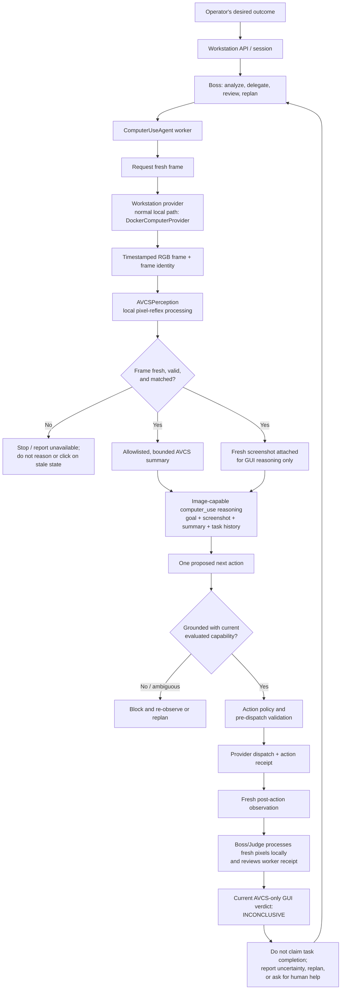

# SONIC + AVCS: Current Desktop Perception and Action Flow

**Status:** Current implementation description, checked 2026-10-30. This
document describes the normal SONIC workstation path; it does not claim that
arbitrary desktop tasks are reliable or that every optional model is ready.
The [computer-user goal](SONIC_COMPUTER_USER_GOAL.md) remains the acceptance
contract.

## The four roles

| Role | Component | Responsibility | Does not prove |
|---|---|---|---|
| Eye / System 1 | AVCS pixel-reflex perception **+ live narration** | Process a fresh desktop frame locally, derive bounded pixel/scene-change signals, and describe what it sees in plain language. | App identity, readable screen text, semantic control identity, or task success. |
| Brain / System 2 | SONIC workstation reasoning | For GUI decisions, interpret the fresh screenshot attached to the image-capable `computer_use` route, alongside bounded AVCS context and task history, then propose the next action. | That the proposed action was dispatched or worked. |
| Hands | Computer/action provider plus policy | Validate and dispatch an allowed GUI or other task-appropriate action; record the result. | That a dispatch changed the intended application state. |
| Independent check | Boss/Judge and task-specific evidence | Review worker receipts and fresh evidence; the current AVCS-only GUI Judge returns inconclusive because it has no validated task-verification head. | Universal reliability or success from scene change alone. |

“System 1” and “System 2” are architectural roles here, not a claim that the
current reflex implementation has human-level perception or cognition.

## Live narration — the eye speaks to the brain

The reflex layer produces numbers; narration turns them into the sentence a
sighted colleague would say out loud. This is the "talking eye" link: the
reasoning model receives local AVCS context and, for GUI decisions, the fresh
workstation screenshot through the image-capable `computer_use` route.

`forge/vision/narrator.py` (`LiveNarrator`) watches the same frame stream the
reflex consumes and emits a `Narration` only when something a human would
notice has changed. `sonic/computer_use/avcs_narrator.py` (`AVCSNarrator`) is
SONIC's side of that contract: it decodes the raw frame already attached to a
`ScreenObservation`, asks the narrator for a line, and renders a bounded prompt
block.

What it reports, and what it must never claim:

| It reports | It never claims |
|---|---|
| Scene tone and structure ("a dark, flat screen") | What any text says — there is no OCR in this path |
| Coarse position of a change ("top-centre") | A semantic control name or a widget type |
| The colour of a newly appeared block ("a red box") | That a colour implies an error, warning, or meaning |
| The visible outcome of a dispatched action | That an unverified action succeeded |

Key properties, all covered by `services/core/tests/test_avcs_live_narration.py`:

* **Colour is compared separately from luminance.** A saturated box whose
  luminance matches its background — a red dialog on a grey desktop — is
  invisible to the luma-only reflex, so the narrator diffs RGB tiles too.
* **Silence is the default.** An unchanged screen yields `None`, so a planner
  is not flooded with restatements. `silence_ratio` makes this measurable.
* **Action feedback is honest.** `action_result()` maps a verified visible
  effect to "the screen responded", an explicitly unseen effect to "no visible
  effect", and an unknown outcome to "dispatched, effect not verified". An
  unverified action is never narrated as success.
* **Narration is advisory.** It is injected into the reasoning prompt labelled
  as a local description that cannot read text and is not proof of success.
  Judge confirmation still requires fresh, task-specific evidence.

Narration is optional at runtime. If the AVCS package or a raw frame is
unavailable the helper returns an empty string and the agent keeps its previous
behaviour, so losing narration never breaks an action.

## End-to-end flow

### 1. Capture and local perception

The normal local workstation provider is `DockerComputerProvider`. The
workstation-side frame stream captures timestamped RGB frames; the provider's
frame-processing worker runs `AVCSPerception` locally on those RGB bytes and
binds the resulting state to the source frame ID. The provider checks that a
frame is new and fresh before returning it. If waiting for a processed frame
times out, it restarts the stream once and retries; a second failure is
reported as unavailable, not as a successful observation.

`ComputerUseAgent.observe()` validates the pixels, dimensions, freshness and
AVCS state. AVCS derives a frame-bound reflex state from pixels locally. The
summary can include frame/screen identity, scene fingerprint, coarse
change/motion values, coarse region kinds, allowlisted event categories and
advisory temporal telemetry. It does not forward arbitrary event text.

### 2. System 2 reasoning

For GUI reasoning, `ComputerUseAgent` builds the prompt after any frame
refresh and attaches that fresh screenshot to the configured image-capable
`computer_use` request, alongside the operator objective, bounded AVCS text
summary, and task history. Screenshot pixels are not sent to a text-only
fallback or to the Judge. If the image-capable route is unavailable, or pixels
or matching fresh AVCS state are missing, stale, malformed or inconsistent,
GUI reasoning fails closed.

The reflex summary is evidence about pixel-derived change, not a natural
language description of the desktop. It must not be interpreted as proof that
the screen contains a named application, text label, button, or requested
result.

### 3. Grounding, policy and execution

System 2 proposes an action; it does not directly control the pointer. A
semantic GUI target must be resolved with current evidence and the configured
local AVCS grounding capability. An explicit pixel point instead needs
current-frame provenance and strict screen-bounds validation; a model-proposed
coordinate by itself is not grounding evidence. Either path must pass
freshness, frame-identity and action-policy checks before provider dispatch.
An ambiguous target or a missing/unready grounding capability blocks the
dependent action.

Semantic pointer grounding and focus verification are separate capabilities.
The goal-conditioned grounder requires recorded demonstration provenance,
held-out evaluation and calibrated per-query confidence evidence. Text entry
also requires evaluated local focus verification. The existence of model
code, a configured path or a checkpoint file alone does not establish
readiness. No live acceptance result in this repository documentation proves
reliable grounding or typing.

The provider performs the action and returns a receipt. Dispatch success is
not task success. The worker must observe the resulting state; Boss reviews
the worker evidence and an independent Judge result before reporting a GUI
task complete.

### 4. Judge and completion

The GUI Judge requires fresh desktop evidence and processes pixels locally
through AVCS. It does not send screenshot pixels to a model. In the current
AVCS-only GUI path, the Judge records the fresh reflex state but returns
`INCONCLUSIVE`: there is no validated local task-verification head to establish
the semantic postcondition. AVCS reflex signals, motion, a changed scene, a
successful input dispatch, or the worker's `GOAL_COMPLETE` proposal alone do
not establish completion. Report the GUI outcome as unconfirmed unless a
separate, task-relevant verification path provides admissible evidence.

## Capability boundaries

- **Implemented:** local frame-stream integration, pixel-reflex state,
  freshness/frame checks, bounded summary for GUI reasoning, one stream
  restart-and-retry, action receipts and fail-closed handling for unsupported
  GUI actions.
- **Optional and gated:** semantic target grounding and focus verification.
  These are usable only when the corresponding local model has valid
  evaluation/provenance evidence and is ready.
- **Not established:** human-like full-screen understanding, reliable
  recognition of arbitrary app names or screen text, universal GUI grounding,
  sustained target-FPS performance, arbitrary multi-step task success, or
  superiority to human users or other computer-use systems.
- **Different execution plane:** a headless task does not need desktop AVCS
  frames. The selected plane must match the assigned task; headless execution
  must not masquerade as visible GUI work.
- **Explicit snapshot boundary:** an authorized dashboard snapshot endpoint
  may encode a frame for display. That API-boundary behavior is distinct from
  sending workstation pixels to reasoning or Judge models.

## Source and related documentation

- [`docs/ARCHITECTURE.md`](ARCHITECTURE.md) — SONIC components and runtime
  boundaries.
- [`docs/SONIC_COMPUTER_USER_GOAL.md`](SONIC_COMPUTER_USER_GOAL.md) — product
  goal and GUI acceptance criteria.
- [`packages/avcs/README.md`](../packages/avcs/README.md) — AVCS package status,
  current capability evidence and experimental features.
- [`packages/avcs/docs/AVCS_ARCHITECTURE.md`](../packages/avcs/docs/AVCS_ARCHITECTURE.md)
  — experimental neural-cortex design, not the active SONIC reflex path.
- [`packages/avcs/docs/AVCS_LLM_INTEGRATION_ROADMAP.md`](../packages/avcs/docs/AVCS_LLM_INTEGRATION_ROADMAP.md)
  — historical integration proposal, not a current delivery/status report.

Primary implementation entry points:
`services/core/sonic/computer/docker_computer.py`,
`services/core/sonic/computer_use/avcs_perception.py`,
`services/core/sonic/computer_use/agent.py`,
`services/core/sonic/computer_use/boss.py`, and
`services/core/sonic/agents/judge.py`.
